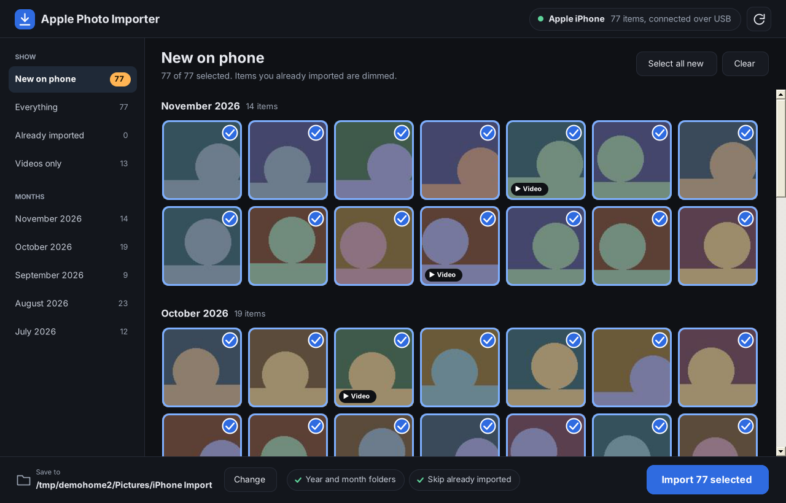
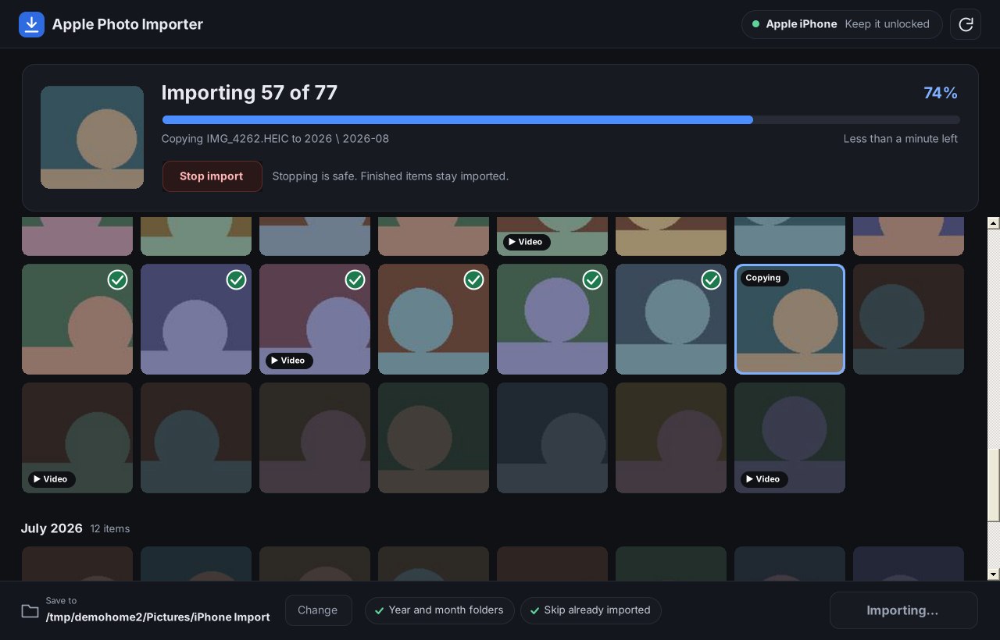
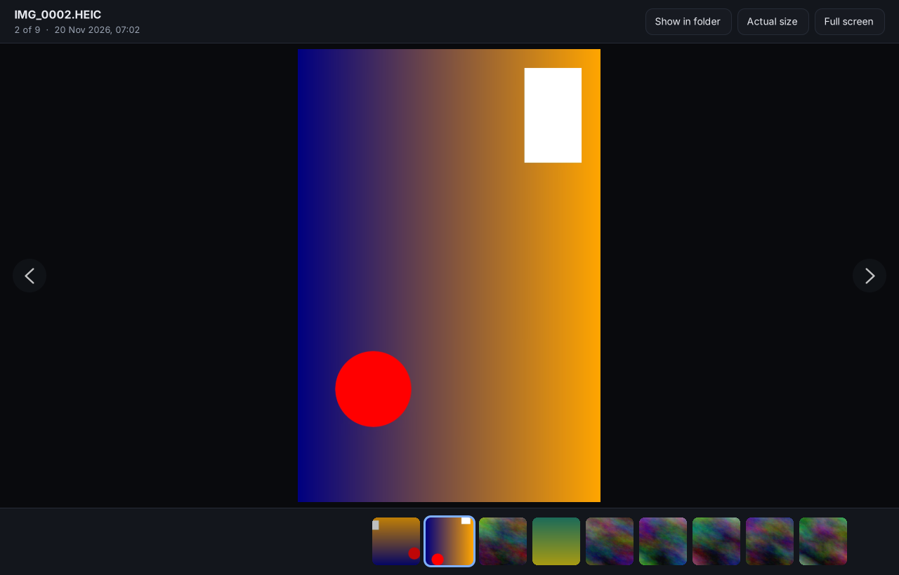

# Apple Photo Importer for Windows

by [Magnetic WP](https://www.magneticwp.com/)

A Windows desktop app that copies photos and videos from an iPhone to a PC over USB, shows HEIC thumbnails in File Explorer, and includes a photo viewer. No iTunes, no iCloud, no Microsoft Store add-ons.



## What it does

**Importer**

- Reads the iPhone directly over USB (Windows Portable Devices), with a thumbnail grid grouped by month.
- Copies only what is new. Already imported items are remembered and skipped on every later run.
- Sorts files into `Year\Year-Month` folders by the date the photo was taken, and keeps that date on the file.
- Retries failed transfers, cancels a transfer the phone stops answering, and stops cleanly if the phone goes quiet.

**HEIC thumbnails in File Explorer**

- Installs a thumbnail handler for `.heic` and `.heif`, using a bundled decoder (libheif).

**Photo viewer**

- Opens HEIC, JPG, PNG, GIF, BMP and TIFF.
- Filmstrip of the folder, next/previous, mouse-wheel zoom, drag to pan, full screen.




## Install

1. Download `PhotoImportSetup.exe` from the [Releases](../../releases) page.
2. Run it. The installer is not code-signed, so Windows SmartScreen shows a warning: choose **More info**, then **Run anyway**.
3. Plug in the iPhone, unlock it, tap **Allow** on the phone, and open **Apple Photo Importer** from the desktop shortcut.

Requirements: 64-bit Windows 10 or 11 (uses the .NET Framework 4.8 that ships with Windows).

## Tips

- Keep the iPhone unlocked while importing.
- On the iPhone, set **Settings → Apps → Photos → Transfer to Mac or PC** to **Keep Originals**.
- If transfers stall or the phone drops out, try a different USB port or cable first.
- After installing, a folder that already showed placeholder icons may need a refresh, or a restart, before HEIC thumbnails appear.

## Status and known limits

This has been used for real on one Windows 11 PC with one iPhone (a library of about 3,100 items). Treat it as early software.

- Thumbnails inside the importer can appear sideways for portrait photos. The iPhone sends its previews unrotated, and reading the rotation from the file broke the phone's connection, so that lookup was removed. Imported files are exact copies and are not affected.
- Videos are imported but not shown in the viewer.
- The installer is unsigned.
- Edit sidecar files (`.AAE`) are skipped.

## Build

The project is built on Linux with Mono's C# compiler and targets the .NET Framework on Windows.

```bash
sudo apt-get install mono-mcs libmono-system-windows-forms4.0-cil libmono-system-drawing4.0-cil nsis python3-pip unzip
./build.sh        # produces dist/PhotoImportSetup.exe
./test.sh         # runs the import-logic tests
```

`build.sh` downloads the prebuilt Windows libheif DLLs from the `pillow-heif` wheel on PyPI into `vendor/`.

One thing to know when changing the code: it is compiled against Mono's libraries but runs on Microsoft's .NET Framework, and a few types and overloads live in different places (for example `Queue<T>`, and `string.Split(char)`). Use only members that exist in .NET Framework 4.x, or the app will fail to start on Windows.

Run the app with `--demo` to try the interface with a simulated phone.

## How it is put together

| File | Purpose |
| --- | --- |
| `src/Wpd.cs` | Windows Portable Devices interop: listing, thumbnails, downloads |
| `src/Model.cs` | Items, the skip index, date-folder placement |
| `src/MainForm.cs` | The importer window and its worker thread |
| `src/Ui.cs` | Custom-drawn dark interface controls |
| `src/Heif.cs` | libheif wrapper for decoding HEIC |
| `src/Viewer.cs` | The photo viewer |
| `src/Thumb.cs` | The File Explorer thumbnail handler |
| `installer.nsi` | NSIS installer script |

## Author and support

Made by [Magnetic WP](https://www.magneticwp.com/).

If this app saved you some time, you can support its development on [Ko-fi](https://ko-fi.com/magneticwp).

## Licence

Copyright (C) 2026 Magnetic WP.

Apple Photo Importer for Windows is free software, released under the [GNU General Public License v3.0](LICENSE).

The installer bundles third-party components under their own licences (libheif, libde265, x265, the MinGW-w64 runtime and the Afacad Flux font). See [THIRD-PARTY-NOTICES.md](THIRD-PARTY-NOTICES.md).

Apple and iPhone are trademarks of Apple Inc. This project is an independent tool and is not affiliated with, sponsored by or endorsed by Apple.
